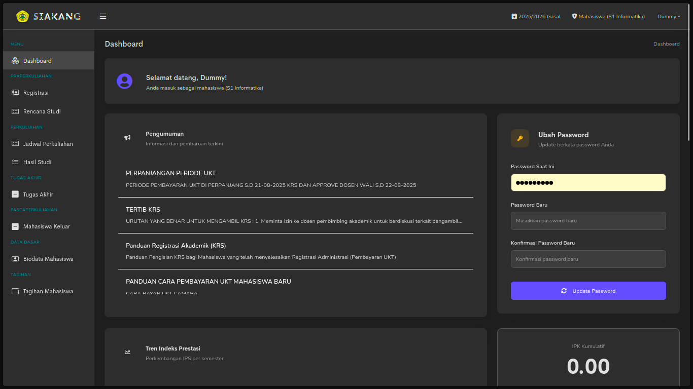

  <h1 align="center">Better Siakang</h1>
  

    <strong>Checking grades is already a horror movie, no need for the jump scare lighting. 👻</strong> 
    A dark theme to save your eyes, plus a sneaky QR bypass to save your sanity.
  

  
  

    <a href="https://github.com/Bitodette/siakang-darkmode/issues">Report Bug</a>
    ·
    <a href="https://github.com/Bitodette/siakang-darkmode/issues">Request Feature</a>
  

  
  

    
    
    
  

---

## 🧐 What is this?

Let's be real: opening **Siakang Untirta** at night is basically a tactical flashbang to the face. 🕶️

**Siakang Dark Mode** is a simple script that turns off the sun. It forces a dark theme on the website so you can check your schedule or cry about your grades in peace, without burning your retinas. 

It also cleans up the messy UI and **lets you bypass the annoying camera requirement for online presence**.

 

---

## ✨ Features

* **Vampire Mode Enabled:** Comprehensive dark background for all major elements. No more white screens.
* **Sneaky QR Upload (NEW!):** Online classes forcing you to point your phone camera at your laptop screen? That's barbaric. Now you can just **upload a screenshot/image** of the lecturer's QR code directly!
* **Actually Readable:** Text colors are fixed so you don't have to squint to read your KHS.
* **Decluttered UI:** I hid the useless stuff. "System Setting"? "Change Language"? Random profile pic? Gone. Clean focus.
* **It Remembers You:** The sidebar size now remembers your preference. No more clicking the burger menu every single time you reload.

---

## 📷 How to use the QR Bypass

Don't have a second device to scan the screen during a Zoom meeting? No problem.

1. Wait for your lecturer to share the QR code on the screen.
2. Take a quick screenshot of it.
3. Go to the Siakang presence page.
4. Click the shiny new **Upload QR** button (it only appears if you haven't checked in yet).
5. Select your screenshot, and boom! You're checked in. The button will disappear once your presence is recorded.

---

## 🚀 How to Install

It's a user script, so you need a manager. It's easy, trust me.

### 1. Get Tampermonkey (The Manager)
If you don't have it yet, grab it here. If you do, skip this.
* [Chrome](https://chrome.google.com/webstore/detail/tampermonkey/dhdgffkkebhmkfjojejmpbldmpobfkfo)
* [Firefox](https://addons.mozilla.org/en-US/firefox/addon/tampermonkey/)
* [Edge](https://microsoftedge.microsoft.com/addons/detail/tampermonkey/iikmkjmpaadaobahmlepeloendndfphd)
* [Safari](https://apps.apple.com/us/app/tampermonkey/id1482490089)

### 2. Install the Script
* Click the **[Install from GreasyFork](https://greasyfork.org/en/scripts/544583-siakang-dark-mode)** button (or the badge at the top).
* Tampermonkey will open a tab asking "Are you sure?".
* Yes, you are sure. Click **Install**.

### 3. Done.
Go to [Siakang Untirta](https://siakang.untirta.ac.id/), log in, and enjoy the darkness. 🖤

---

## ⚠️ Disclaimer (Penting)

* **Client-Side Only:** This script only changes how the site *looks* and behaves on your browser.
* **QR Upload is NOT Magic:** You still need the *actual, valid* QR code from your lecturer. This just automates the scanning process from an image so you don't need two devices.
* **I Can't Fix Your Grades:** It does **NOT** touch the database. I cannot change your 'E' to an 'A'. Sorry, you're on your own for that one. 💀
* **Safe:** No data is sent anywhere. 

---

## 🤝 Contributing

Found a bug? Or maybe the CSS broke because the campus updated the site?
Feel free to **fork** this repo and submit a **Pull Request**.

If you like this project (or if it saved your eyes), give it a ⭐ **Star**! 

---

  <i>Made with ❤️ (and caffeine) by Bitodette</i>

